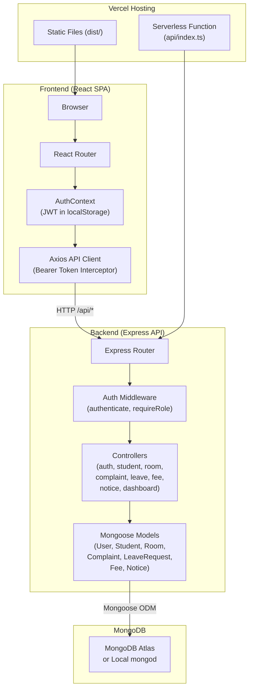
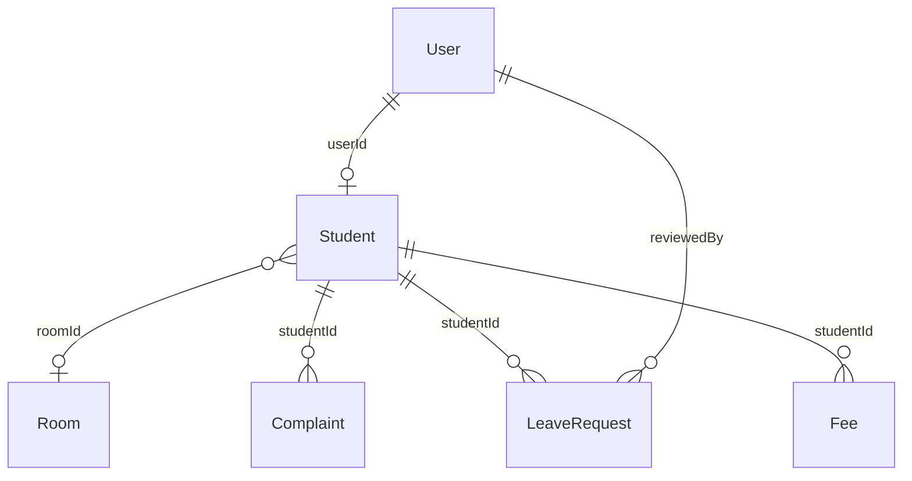

# Smart Hostel Management System — Project Documentation

> **Gujarat Technological University (GTU) · B.E. Semester 5**
> **Subjects:** Web Application Development (WAD) & Advanced Database Management System (ADBMS)
> **Repository:** [https://github.com/juned-builds/Smart-Hostel-management-System-.git](https://github.com/juned-builds/Smart-Hostel-management-System-.git)

---

## Table of Contents

1. [Project Overview](#1-project-overview)
2. [Features](#2-features)
3. [Technology Stack](#3-technology-stack)
4. [System Architecture](#4-system-architecture)
5. [Project Folder Structure](#5-project-folder-structure)
6. [Database Design](#6-database-design)
7. [Authentication and Authorization](#7-authentication-and-authorization)
8. [API Reference](#8-api-reference)
9. [Installation and Local Setup](#9-installation-and-local-setup)
10. [Environment Variables](#10-environment-variables)
11. [Database Setup and Demo Data](#11-database-setup-and-demo-data)
12. [Responsive UI](#12-responsive-ui)
13. [Build, Testing, and Deployment](#13-build-testing-and-deployment)
14. [Security Considerations](#14-security-considerations)
15. [Known Limitations and Future Improvements](#15-known-limitations-and-future-improvements)
16. [Troubleshooting](#16-troubleshooting)
17. [Project Summary](#17-project-summary)

---

## 1. Project Overview

### Purpose

The **Smart Hostel Management System** is a full-stack web application designed to digitise and streamline the administrative and operational workflows of a college hostel environment. It provides a unified portal for hostel wardens (admins) and resident students to manage room allocations, complaints, leave requests, fee invoices, and hostel notices.

### Problem Statement

Traditional hostel management relies on paper registers, manual record-keeping, and in-person queues for complaint filing and leave approvals. This approach is error-prone, time-consuming, and lacks real-time visibility into occupancy, fee status, and complaint resolution. The Smart Hostel Management System replaces these manual processes with a role-based web portal backed by a cloud-ready MongoDB database.

### Objectives

- Provide separate, role-protected dashboards for **Admin (Warden)** and **Student** users.
- Enable CRUD operations for students, rooms, complaints, leave requests, fee records, and notices.
- Demonstrate JWT-based authentication, role-based authorization, and RESTful API design.
- Utilise MongoDB aggregation pipelines for real-time dashboard statistics (occupancy rates, fee collection, complaint breakdowns).
- Deliver a responsive, mobile-friendly interface deployable to Vercel.

---

## 2. Features

### 2.1 Admin (Warden) Features

| Module | Capabilities |
|---|---|
| **Dashboard** | Aggregated statistics: student counts (total, active, allocated, unallocated), room occupancy rate, complaint breakdown by status and category, leave request summary, fee collection vs. pending amounts, room distribution by block, and recent activity feeds. |
| **Student Directory** | List all students with search (name, enrollment, email, phone), filters (department, semester, allocation status, active status), and pagination. Create new student accounts (auto-creates User + Student documents with hashed password). Edit student profiles. Delete students (auto-deallocates room bed and removes User record). |
| **Room Inventory** | List rooms with filters (block, status, type). Create new rooms. Edit room details (block, floor, capacity, type, monthly rent). Delete rooms (only if unoccupied). Each room listing includes current occupant details. |
| **Room Allocations** | Allocate an unallocated student to an available room with a bed number. Deallocate a student from their current room. Handles room occupancy counters and status transitions (Available ↔ Full) automatically. Prevents allocation to full rooms and re-allocation to the same room. |
| **Complaint Management** | View all complaints with filters (status, category, priority). Update complaint status (Pending → In Progress → Resolved / Rejected) and add resolution remarks. Automatically records `resolvedAt` timestamp when marked Resolved. |
| **Leave Management** | View all leave requests with filters (status, leave type). Approve or reject leave requests with admin remarks. Records `reviewedBy` (admin user ID) and `reviewedAt` timestamp. |
| **Fee Management** | View all fee invoices with filters (status, academic year). Create new fee invoices for students. Update fee records: change status, paid amount, payment mode, due date, and remarks. Mark fees as Paid (auto-generates receipt number and records payment date). |
| **Notice Board** | View all active notices. Create new notices with category and priority. Edit existing notices (title, content, category, priority, posted by, active status). Delete notices. |
| **Database Reset** | One-click "Reset Demo Data" button in the Navbar to restore all collections to the default seed state (available in development; intentionally excluded from the Vercel production serverless entry). |

### 2.2 Student Features

| Module | Capabilities |
|---|---|
| **Dashboard** | Personal overview: profile details, allocated room information, roommate list, recent complaint statuses, upcoming leave dates, fee payment status, and latest hostel notices. |
| **Profile** | View personal information (enrollment number, department, semester, guardian details, address). |
| **Room & Roommates** | View allocated room details (room number, block, floor, type, rent). View roommate contact information. |
| **Complaints** | View own complaint history. Submit new complaints with title, description, category, and priority. |
| **Leave Requests** | View own leave request history and statuses. Submit new leave applications with leave type, date range, reason, destination address, and emergency contact. |
| **Hostel Fees** | View own fee invoices and payment statuses. Simulate fee payment (marks fee as Paid, generates receipt number). |
| **Notice Board** | View all active hostel notices posted by the administration. |

### 2.3 Authentication

- JWT-based email/password login with role detection.
- Session verification on page load via `/api/auth/me`.
- Password change functionality for authenticated users.
- Automatic redirect based on role (admin → `/admin/dashboard`, student → `/student/dashboard`).

---

## 3. Technology Stack

| Layer | Technology | Role |
|---|---|---|
| **Frontend Framework** | React 19 | Component-based SPA with hooks and context API for state management. |
| **Language** | TypeScript 7 | Static typing across both frontend and backend codebases. |
| **Build Tool** | Vite 8 | Fast HMR development server and optimised production bundling. |
| **CSS Framework** | Tailwind CSS 4 | Utility-first responsive styling via the `@tailwindcss/vite` plugin. |
| **Routing** | React Router DOM 7 | Client-side routing with nested layouts and role-guarded routes. |
| **Icons** | Lucide React | Consistent icon set (Building2, Users, BedDouble, AlertCircle, etc.). |
| **Animations** | Motion (Framer Motion) | UI micro-animations and transitions. |
| **HTTP Client** | Axios | API communication with request/response interceptors for JWT injection and 401 handling. |
| **Backend Runtime** | Node.js + Express 4 | RESTful API server with JSON body parsing and error middleware. |
| **Authentication** | jsonwebtoken + bcryptjs | JWT token signing/verification and password hashing (bcrypt, 10 salt rounds). |
| **Database** | MongoDB (via Mongoose 9) | Document-oriented storage with schemas, indexes, population, and aggregation pipelines. |
| **Dev Runner** | tsx | TypeScript execution for `server.ts` without a separate compilation step. |
| **Deployment** | Vercel | Frontend static hosting + serverless API functions via `api/index.ts`. |

---

## 4. System Architecture

### Overview

The application follows a **monorepo** structure with a shared TypeScript codebase. In development, an Express server (`server.ts`) runs with Vite middleware for HMR. In production (Vercel), the frontend is pre-built as static files and the backend runs as a Vercel Serverless Function (`api/index.ts`).

### Architecture Diagram



### Request Flow

1. The React frontend renders pages based on the authenticated user's role.
2. Axios sends API requests to `/api/*` with a `Bearer <JWT>` header injected by a request interceptor.
3. Express routes pass requests through `authenticate` middleware (JWT verification) and optionally `requireRole` middleware.
4. Controllers execute business logic, interacting with Mongoose models.
5. Mongoose performs queries and aggregations against the connected MongoDB instance.
6. JSON responses flow back through Express to the Axios response handler.
7. A response interceptor clears `localStorage` on HTTP 401 to force re-authentication.

---

## 5. Project Folder Structure

```
smart-hostel-management-system/
├── api/
│   └── index.ts                  # Vercel serverless function entry point
├── server/
│   ├── config/
│   │   └── db.ts                 # MongoDB connection logic (connectDB, disconnectDB)
│   ├── controllers/
│   │   ├── authController.ts     # login, getMe, changePassword
│   │   ├── studentController.ts  # CRUD + search/filter/pagination for students
│   │   ├── roomController.ts     # CRUD for rooms + allocate/deallocate logic
│   │   ├── complaintController.ts# List, create, update complaint status
│   │   ├── leaveController.ts    # List, create, review (approve/reject) leaves
│   │   ├── feeController.ts      # List, create, update, pay fee records
│   │   ├── noticeController.ts   # CRUD for hostel notices
│   │   └── dashboardController.ts# Aggregation-based admin dashboard statistics
│   ├── middleware/
│   │   └── auth.ts               # JWT authenticate, requireRole, getJwtSecret
│   ├── models/
│   │   ├── User.ts               # User schema (name, email, password, role)
│   │   ├── Student.ts            # Student profile schema (refs User, Room)
│   │   ├── Room.ts               # Room schema (capacity, occupied, status, rent)
│   │   ├── Complaint.ts          # Complaint schema (category, priority, status)
│   │   ├── LeaveRequest.ts       # Leave request schema (type, dates, status)
│   │   ├── Fee.ts                # Fee invoice schema (amount, status, payment)
│   │   └── Notice.ts             # Notice schema (category, priority, postedBy)
│   ├── routes/
│   │   ├── authRoutes.ts         # /api/auth/*
│   │   ├── studentRoutes.ts      # /api/students/*
│   │   ├── roomRoutes.ts         # /api/rooms/* and /api/allocations/*
│   │   ├── complaintRoutes.ts    # /api/complaints/*
│   │   ├── leaveRoutes.ts        # /api/leaves/*
│   │   ├── feeRoutes.ts          # /api/fees/*
│   │   ├── noticeRoutes.ts       # /api/notices/*
│   │   └── dashboardRoutes.ts    # /api/dashboard/*
│   └── seed/
│       └── seedData.ts           # Demo data seeder (users, rooms, students, etc.)
├── src/
│   ├── api/
│   │   └── client.ts             # Axios instance with JWT interceptors
│   ├── components/
│   │   ├── Badge.tsx             # Reusable status badge component
│   │   ├── Modal.tsx             # Reusable modal dialog component
│   │   ├── Navbar.tsx            # Top navigation bar with user info and logout
│   │   ├── Sidebar.tsx           # Role-aware navigation sidebar (desktop + mobile)
│   │   └── StatCard.tsx          # Dashboard statistic card component
│   ├── context/
│   │   └── AuthContext.tsx       # React context for auth state (login, logout, token)
│   ├── layouts/
│   │   └── DashboardLayout.tsx   # Protected layout with Sidebar + Navbar + Outlet
│   ├── pages/
│   │   ├── Login.tsx             # Login page with email/password form
│   │   ├── admin/
│   │   │   ├── AdminDashboard.tsx
│   │   │   ├── StudentManagement.tsx
│   │   │   ├── RoomManagement.tsx
│   │   │   ├── AllocationManagement.tsx
│   │   │   ├── ComplaintManagement.tsx
│   │   │   ├── LeaveManagement.tsx
│   │   │   ├── FeeManagement.tsx
│   │   │   └── NoticeManagement.tsx
│   │   └── student/
│   │       ├── StudentDashboard.tsx
│   │       ├── StudentProfile.tsx
│   │       ├── StudentRoom.tsx
│   │       ├── StudentComplaints.tsx
│   │       ├── StudentLeaves.tsx
│   │       ├── StudentFees.tsx
│   │       └── StudentNotices.tsx
│   ├── types/
│   │   └── index.ts              # Shared TypeScript interfaces
│   ├── index.css                 # Global styles and Tailwind directives
│   ├── main.tsx                  # React DOM render entry point
│   └── App.tsx                   # Root component with BrowserRouter and route definitions
├── index.html                    # Vite HTML entry with SEO meta tags
├── server.ts                     # Development/local Express server entry point
├── package.json                  # Dependencies and npm scripts
├── tsconfig.json                 # TypeScript compiler configuration
├── vite.config.ts                # Vite build and plugin configuration
├── vercel.json                   # Vercel rewrite rules for SPA + API routing
├── .env.example                  # Template for environment variables
└── .gitignore                    # Excludes node_modules, dist, .env files
```

---

## 6. Database Design

The application uses **7 Mongoose collections** with document references (`ObjectId` refs) to establish relationships.

### 6.1 Entity-Relationship Overview



### 6.2 Collection Schemas

#### `users`

| Field | Type | Constraints | Description |
|---|---|---|---|
| `name` | String | Required, trimmed | Full name of the user. |
| `email` | String | Required, unique, lowercase, trimmed | Login email address. |
| `password` | String | Required | Bcrypt-hashed password. |
| `role` | String | Enum: `admin`, `student`. Default: `student` | Determines portal access level. |
| `createdAt` | Date | Auto (timestamps) | Account creation timestamp. |
| `updatedAt` | Date | Auto (timestamps) | Last modification timestamp. |

**Indexes:** `email` (ascending), `role` (ascending).

#### `students`

| Field | Type | Constraints | Description |
|---|---|---|---|
| `userId` | ObjectId | Required, unique, ref → `User` | Links to the User login account. |
| `enrollmentNo` | String | Required, unique, uppercase, trimmed | GTU enrollment number (e.g., `GTU2024BE01`). |
| `fullName` | String | Required, trimmed | Student's full name. |
| `email` | String | Required, unique, lowercase, trimmed | Contact email. |
| `phone` | String | Required, trimmed | Phone number. |
| `department` | String | Required. Default: `Computer Engineering` | Academic department. |
| `semester` | Number | Required, min: 1, max: 8. Default: `5` | Current semester. |
| `gender` | String | Enum: `Male`, `Female`, `Other`. Default: `Male` | Gender. |
| `guardianName` | String | Default: `""` | Parent/guardian name. |
| `guardianPhone` | String | Default: `""` | Guardian contact number. |
| `address` | String | Default: `""` | Permanent address. |
| `roomId` | ObjectId \| null | Ref → `Room`. Default: `null` | Allocated room (null if unallocated). |
| `bedNo` | String | Default: `""` | Bed number within the room. |
| `isActive` | Boolean | Default: `true` | Whether the student is an active resident. |

**Indexes:** `enrollmentNo` (ascending), `roomId` (ascending), `department` (ascending).

#### `rooms`

| Field | Type | Constraints | Description |
|---|---|---|---|
| `roomNumber` | String | Required, unique, uppercase, trimmed | Room identifier (e.g., `A-101`). |
| `block` | String | Required, trimmed | Hostel block name (e.g., `Block A (Boys)`). |
| `floor` | Number | Required, min: 0 | Floor number. |
| `capacity` | Number | Required, min: 1. Default: `2` | Maximum bed count. |
| `occupied` | Number | Required, min: 0. Default: `0` | Current occupant count. |
| `type` | String | Enum: `Standard`, `Deluxe`, `AC`, `Non-AC`. Default: `Standard` | Room category. |
| `status` | String | Enum: `Available`, `Full`, `Maintenance`. Default: `Available` | Availability status. |
| `monthlyRent` | Number | Default: `4500` | Monthly rent in INR. |

**Indexes:** `roomNumber` (ascending), `status` (ascending), `block` (ascending).

#### `complaints`

| Field | Type | Constraints | Description |
|---|---|---|---|
| `studentId` | ObjectId | Required, ref → `Student` | The student who filed the complaint. |
| `title` | String | Required, trimmed | Complaint title. |
| `description` | String | Required, trimmed | Detailed description. |
| `category` | String | Enum: `Electrical`, `Plumbing`, `Carpentry`, `Cleaning`, `Wi-Fi/Internet`, `Mess/Food`, `Other`. Default: `Other` | Issue category. |
| `priority` | String | Enum: `Low`, `Medium`, `High`. Default: `Medium` | Urgency level. |
| `status` | String | Enum: `Pending`, `In Progress`, `Resolved`, `Rejected`. Default: `Pending` | Resolution status. |
| `resolutionRemarks` | String | Default: `""` | Admin's resolution notes. |
| `resolvedAt` | Date | Optional | Timestamp when marked as Resolved. |

**Indexes:** `studentId` (ascending), `status` (ascending), `category` (ascending).

#### `leaverequests`

| Field | Type | Constraints | Description |
|---|---|---|---|
| `studentId` | ObjectId | Required, ref → `Student` | The student requesting leave. |
| `leaveType` | String | Enum: `Home Visit`, `Medical`, `Academic/Event`, `Emergency`, `Other`. Default: `Home Visit` | Type of leave. |
| `startDate` | Date | Required | Leave start date. |
| `endDate` | Date | Required | Leave end date. |
| `reason` | String | Required, trimmed | Justification for the leave. |
| `destinationAddress` | String | Default: `""` | Where the student will stay during leave. |
| `emergencyContact` | String | Default: `""` | Emergency phone number during absence. |
| `status` | String | Enum: `Pending`, `Approved`, `Rejected`. Default: `Pending` | Approval status. |
| `adminRemarks` | String | Default: `""` | Warden's remarks on the decision. |
| `reviewedBy` | ObjectId | Optional, ref → `User` | Admin who reviewed the request. |
| `reviewedAt` | Date | Optional | Timestamp of review. |

**Indexes:** `studentId` (ascending), `status` (ascending).

#### `fees`

| Field | Type | Constraints | Description |
|---|---|---|---|
| `studentId` | ObjectId | Required, ref → `Student` | Student associated with this invoice. |
| `academicYear` | String | Required. Default: `2024-2025` | Academic year. |
| `term` | String | Required. Default: `Semester 5 (Odd Term)` | Semester/term label. |
| `amount` | Number | Required, min: 0 | Total fee amount in INR. |
| `paidAmount` | Number | Default: `0`, min: 0 | Amount paid so far. |
| `dueDate` | Date | Required | Payment deadline. |
| `status` | String | Enum: `Paid`, `Pending`, `Partial`, `Overdue`. Default: `Pending` | Payment status. |
| `paymentDate` | Date | Optional | Date payment was received. |
| `paymentMode` | String | Enum: `UPI`, `Net Banking`, `Cash`, `Demand Draft`, `Card`. Optional | Payment method used. |
| `receiptNo` | String | Optional | Auto-generated receipt identifier. |
| `remarks` | String | Default: `""` | Additional notes. |

**Indexes:** `studentId` (ascending), `status` (ascending), `academicYear` (ascending).

#### `notices`

| Field | Type | Constraints | Description |
|---|---|---|---|
| `title` | String | Required, trimmed | Notice headline. |
| `content` | String | Required, trimmed | Full notice body text. |
| `category` | String | Enum: `General`, `Rules & Regulations`, `Fee Deadline`, `Mess Notice`, `Urgent`. Default: `General` | Notice category. |
| `priority` | String | Enum: `Normal`, `Important`, `High Priority`. Default: `Normal` | Display priority. |
| `postedBy` | String | Default: `Hostel Rector / Warden` | Author attribution. |
| `isActive` | Boolean | Default: `true` | Whether the notice is visible. |

**Indexes:** `createdAt` (descending), `priority` (ascending).

---

## 7. Authentication and Authorization

### 7.1 Login Flow

1. The user submits email and password to `POST /api/auth/login`.
2. The server normalises the email (lowercase, trimmed) and looks up the `User` document.
3. The password is verified against the stored bcrypt hash using `bcrypt.compare()`.
4. If the user has role `student`, the corresponding `Student` document is fetched to include `studentId` in the token payload.
5. A JWT is signed with the payload `{ userId, role, email, studentId? }` using `jwt.sign()` with a **7-day expiry** (`expiresIn: '7d'`).
6. The token and user metadata are returned to the client.

### 7.2 Client-Side Token Management

- The JWT token is stored in `localStorage` under the key `hostel_token`.
- User metadata is stored under `hostel_user`.
- An Axios **request interceptor** reads `hostel_token` from `localStorage` and attaches it as a `Bearer` token in the `Authorization` header of every API request.
- An Axios **response interceptor** clears `localStorage` on HTTP `401` responses (when not on the login page), forcing the user back to the login screen.
- On app load, `AuthContext` calls `GET /api/auth/me` to verify the stored token's validity and refresh user data.

### 7.3 Server-Side Middleware

| Middleware | File | Behaviour |
|---|---|---|
| `authenticate` | `server/middleware/auth.ts` | Extracts the Bearer token from the `Authorization` header, verifies it with `jwt.verify()`, and attaches the decoded payload to `req.user`. Returns `401` if the token is missing, malformed, or expired. |
| `requireRole(...roles)` | `server/middleware/auth.ts` | Checks `req.user.role` against the allowed roles array. Returns `403` if the user's role is not permitted. |
| `getJwtSecret()` | `server/middleware/auth.ts` | Reads `JWT_SECRET` from environment variables. Throws a fatal error if the variable is missing or empty; the server exits on startup if this fails. |

### 7.4 Route-Level Permissions

| Route Group | Auth Required | Role Restriction |
|---|---|---|
| `POST /api/auth/login` | No | None (public) |
| `GET /api/auth/me` | Yes | Any authenticated user |
| `POST /api/auth/change-password` | Yes | Any authenticated user |
| `GET /api/students` | Yes | Admin only |
| `GET /api/students/:id` | Yes | Admin or the student themselves |
| `POST/PUT/DELETE /api/students/*` | Yes | Admin only |
| `GET /api/rooms`, `GET /api/rooms/:id` | Yes | Any authenticated user |
| `POST/PUT/DELETE /api/rooms/*` | Yes | Admin only |
| `POST /api/allocations` | Yes | Admin only |
| `POST /api/allocations/deallocate` | Yes | Admin only |
| `GET /api/complaints` | Yes | Admin sees all; Student sees own |
| `POST /api/complaints` | Yes | Any authenticated user (student context) |
| `PUT /api/complaints/:id` | Yes | Admin only |
| `GET /api/leaves` | Yes | Admin sees all; Student sees own |
| `POST /api/leaves` | Yes | Any authenticated user (student context) |
| `PUT /api/leaves/:id` | Yes | Admin only |
| `GET /api/fees` | Yes | Admin sees all; Student sees own |
| `POST /api/fees` | Yes | Admin only |
| `PUT /api/fees/:id` | Yes | Admin only |
| `POST /api/fees/:id/pay` | Yes | Any authenticated user |
| `GET /api/notices` | Yes | Any authenticated user |
| `POST/PUT/DELETE /api/notices/*` | Yes | Admin only |
| `GET /api/dashboard/stats` | Yes | Admin only |
| `GET /api/health` | No | None (public) |
| `POST /api/seed/reset` | No | None (dev only; not exposed in Vercel) |

### 7.5 Frontend Route Protection

The `DashboardLayout` component checks `isAuthenticated` and the `requiredRole` prop. Unauthenticated users are redirected to `/login`. Users accessing a route meant for a different role are redirected to their own dashboard. A catch-all route (`*`) redirects to `/`, which in turn redirects based on authentication state and role.

---

## 8. API Reference

### 8.1 Authentication

| Method | Endpoint | Auth | Description |
|---|---|---|---|
| `POST` | `/api/auth/login` | No | Authenticate with email and password. Returns JWT token and user object. |
| `GET` | `/api/auth/me` | Yes | Retrieve the current authenticated user's profile. For students, includes the populated Student document with room details. |
| `POST` | `/api/auth/change-password` | Yes | Change the authenticated user's password. Requires `currentPassword` and `newPassword` (min 6 characters). |

**Login Request:**
```json
{
  "email": "admin@hostel.com",
  "password": "admin123"
}
```

**Login Response (success):**
```json
{
  "success": true,
  "message": "Login successful.",
  "token": "<JWT_TOKEN>",
  "user": {
    "id": "...",
    "name": "Prof. Ramesh Patel (Chief Warden)",
    "email": "admin@hostel.com",
    "role": "admin",
    "studentId": null,
    "enrollmentNo": null
  }
}
```

### 8.2 Students

| Method | Endpoint | Auth | Role | Description |
|---|---|---|---|---|
| `GET` | `/api/students` | Yes | Admin | List students. Query params: `search`, `department`, `semester`, `allocationStatus` (`allocated`/`unallocated`), `isActive`, `page`, `limit`. |
| `GET` | `/api/students/:id` | Yes | Admin or Self | Get student details with roommate list. |
| `POST` | `/api/students` | Yes | Admin | Create a new student. Auto-creates a User account with hashed password (default: `student123`). |
| `PUT` | `/api/students/:id` | Yes | Admin | Update student profile fields. |
| `DELETE` | `/api/students/:id` | Yes | Admin | Delete student and their User account. Deallocates room bed if assigned. |

**Create Student Request:**
```json
{
  "fullName": "New Student",
  "enrollmentNo": "GTU2024BE10",
  "email": "newstudent@hostel.com",
  "phone": "+91 98765 00000",
  "department": "Computer Engineering",
  "semester": 5,
  "gender": "Male",
  "guardianName": "Guardian Name",
  "guardianPhone": "+91 98765 11111",
  "address": "City, Gujarat",
  "password": "student123"
}
```

### 8.3 Rooms

| Method | Endpoint | Auth | Role | Description |
|---|---|---|---|---|
| `GET` | `/api/rooms` | Yes | Any | List rooms with occupant details. Query params: `block`, `status`, `type`, `onlyAvailable`. |
| `GET` | `/api/rooms/:id` | Yes | Any | Get single room details with occupant list and available bed count. |
| `POST` | `/api/rooms` | Yes | Admin | Create a new room. |
| `PUT` | `/api/rooms/:id` | Yes | Admin | Update room details. Prevents reducing capacity below current occupancy. |
| `DELETE` | `/api/rooms/:id` | Yes | Admin | Delete a room. Fails if the room has allocated students. |

### 8.4 Allocations

| Method | Endpoint | Auth | Role | Description |
|---|---|---|---|---|
| `POST` | `/api/allocations` | Yes | Admin | Allocate a student to a room. Body: `{ studentId, roomId, bedNo? }`. Auto-increments room `occupied` count. If student was in another room, that room's count is decremented. |
| `POST` | `/api/allocations/deallocate` | Yes | Admin | Remove a student from their room. Body: `{ studentId }`. Decrements room `occupied` count, clears student's `roomId` and `bedNo`. |

### 8.5 Complaints

| Method | Endpoint | Auth | Role | Description |
|---|---|---|---|---|
| `GET` | `/api/complaints` | Yes | Any | Admin: all complaints with optional filters (`status`, `category`, `priority`). Student: own complaints only. Includes populated student and room info. |
| `POST` | `/api/complaints` | Yes | Any | Submit a new complaint. Body: `{ title, description, category?, priority? }`. Student ID is derived from the JWT. |
| `PUT` | `/api/complaints/:id` | Yes | Admin | Update complaint status and resolution remarks. Body: `{ status, resolutionRemarks? }`. Sets `resolvedAt` when status is `Resolved`. |

### 8.6 Leave Requests

| Method | Endpoint | Auth | Role | Description |
|---|---|---|---|---|
| `GET` | `/api/leaves` | Yes | Any | Admin: all leave requests with optional filters (`status`, `leaveType`). Student: own requests only. |
| `POST` | `/api/leaves` | Yes | Any | Submit a leave application. Body: `{ leaveType?, startDate, endDate, reason, destinationAddress?, emergencyContact? }`. Validates `endDate >= startDate`. |
| `PUT` | `/api/leaves/:id` | Yes | Admin | Approve or reject a leave request. Body: `{ status, adminRemarks? }`. Records `reviewedBy` and `reviewedAt`. |

### 8.7 Fees

| Method | Endpoint | Auth | Role | Description |
|---|---|---|---|---|
| `GET` | `/api/fees` | Yes | Any | Admin: all fee records with optional filters (`status`, `academicYear`). Student: own fee records only. |
| `POST` | `/api/fees` | Yes | Admin | Create a fee invoice. Body: `{ studentId, amount, dueDate, academicYear?, term?, status?, remarks? }`. |
| `PUT` | `/api/fees/:id` | Yes | Admin | Update fee record. Body: `{ status?, paidAmount?, paymentMode?, remarks?, dueDate? }`. Auto-generates receipt on `Paid`. |
| `POST` | `/api/fees/:id/pay` | Yes | Any | Simulated payment. Body: `{ paymentMode? }`. Marks fee as `Paid`, sets `paidAmount` to full amount, generates receipt number. |

### 8.8 Notices

| Method | Endpoint | Auth | Role | Description |
|---|---|---|---|---|
| `GET` | `/api/notices` | Yes | Any | List active notices. Query params: `category`, `priority`. Sorted by newest first. |
| `POST` | `/api/notices` | Yes | Admin | Create a notice. Body: `{ title, content, category?, priority?, postedBy? }`. |
| `PUT` | `/api/notices/:id` | Yes | Admin | Update a notice. Body: `{ title?, content?, category?, priority?, postedBy?, isActive? }`. |
| `DELETE` | `/api/notices/:id` | Yes | Admin | Permanently delete a notice. |

### 8.9 Dashboard

| Method | Endpoint | Auth | Role | Description |
|---|---|---|---|---|
| `GET` | `/api/dashboard/stats` | Yes | Admin | Returns aggregated statistics: student counts, room occupancy (via MongoDB aggregation pipeline), complaints by status/category, leaves by status, fee collection totals, room distribution by block, and 5 most recent complaints, leaves, and notices. |

### 8.10 System

| Method | Endpoint | Auth | Description |
|---|---|---|---|
| `GET` | `/api/health` | No | Health check returning app name, database connection state, host, port, and timestamp. Returns `200` if DB connected, `503` otherwise. |
| `POST` | `/api/seed/reset` | No | **Development only.** Drops all collection data and re-seeds with demo records. Not exposed in Vercel production. |

---

## 9. Installation and Local Setup

### Prerequisites

- **Node.js** ≥ 18 (LTS recommended)
- **npm** (bundled with Node.js) or **bun** (a `bun.lock` is present in the repo)
- **MongoDB** — either a local `mongod` instance (Community Server) or a MongoDB Atlas cluster
- **Git**

### Steps

```bash
# 1. Clone the repository
git clone https://github.com/juned-builds/Smart-Hostel-management-System-.git
cd Smart-Hostel-management-System-

# 2. Install dependencies
npm install

# 3. Create the environment file
cp .env.example .env
# Edit .env with your MongoDB URI and JWT secret (see Section 10)

# 4. Start the development server
npm run dev
```

The server starts at `http://localhost:3001` (or the port configured in `.env`). On first launch, the database is automatically seeded with demo data if the `users` collection is empty.

### Demo Credentials

| Role | Email | Password |
|---|---|---|
| Admin (Warden) | `admin@hostel.com` | `admin123` |
| Student | `student@hostel.com` | `student123` |

Additional student accounts seeded: `priya@hostel.com`, `aarav@hostel.com`, `ananya@hostel.com`, `rohit@hostel.com` — all with password `student123`.

---

## 10. Environment Variables

Create a `.env` file in the project root. **Never commit real secrets to version control.**

| Variable | Required | Description | Example (placeholder) |
|---|---|---|---|
| `MONGODB_URI` | Yes | MongoDB connection string. Use a local URI for development or a MongoDB Atlas URI for production. | `mongodb://127.0.0.1:27017/smart_hostel` |
| `JWT_SECRET` | Yes | Secret key for signing and verifying JWT tokens. Must be a strong, random string in production. | `your_strong_random_secret_key_here` |
| `PORT` | No | Port for the local Express server. Default: `3001`. | `3001` |

> **⚠️ Security Warning:** The `.env.example` file in the repository contains example values for convenience. Replace them with unique, strong values before deploying to production. The `.gitignore` excludes all `.env*` files except `.env.example`.

---

## 11. Database Setup and Demo Data

### MongoDB Configuration

**Local Development:**
1. Install [MongoDB Community Server](https://www.mongodb.com/try/download/community).
2. Start the `mongod` service.
3. Set `MONGODB_URI=mongodb://127.0.0.1:27017/smart_hostel` in your `.env` file.

**MongoDB Atlas (Production / Cloud):**
1. Create a free-tier cluster at [MongoDB Atlas](https://www.mongodb.com/cloud/atlas).
2. Create a database user and whitelist your IP (or use `0.0.0.0/0` for Vercel).
3. Copy the connection string and set it as `MONGODB_URI` in your `.env` or Vercel environment variables.

### Automatic Seeding

The `seedDatabase()` function in `server/seed/seedData.ts` runs automatically on server startup:

- **Condition:** Only seeds if the `users` collection is empty (`User.countDocuments() === 0`) and `force` is `false`.
- **What it creates:**
  - 1 admin user (Prof. Ramesh Patel, Chief Warden)
  - 5 student users with corresponding Student profiles
  - 5 rooms across 3 blocks (A, B, C) with varied types and capacities
  - 4 student-to-room allocations (Rohan & Aarav in A-101; Priya & Ananya in B-202; Rohit is unallocated)
  - 4 complaints in various statuses
  - 3 leave requests in various statuses
  - 3 hostel notices
  - 4 fee invoices in various payment states

### Database Reset

> **⚠️ Caution:** The reset operation **deletes all existing records** from all 7 collections (users, students, rooms, complaints, leaverequests, fees, notices) before re-inserting the demo data.

**Via UI (development only):** Click the **"Reset Demo Data"** button in the top navigation bar. Requires confirmation.

**Via API (development only):**
```bash
curl -X POST http://localhost:3001/api/seed/reset
```

The reset endpoint (`POST /api/seed/reset`) is only available in the local development server (`server.ts`). It is intentionally **not exposed** in the Vercel serverless function (`api/index.ts`) to protect production data.

---

## 12. Responsive UI

The frontend is fully responsive, built with Tailwind CSS utility classes targeting multiple breakpoints.

### Navigation

- **Desktop (≥ 1024px / `lg`):** A fixed 256px-wide sidebar on the left with navigation links organised by role. The sidebar footer displays "GTU Hostel Management · BE Sem 5 Project" and a MongoDB connection status indicator.
- **Mobile / Tablet (< 1024px):** The sidebar is hidden off-screen by default. A hamburger menu button (☰) appears in the Navbar. Tapping it slides the sidebar in from the left with a semi-transparent backdrop overlay. Tapping the overlay or a navigation link closes the drawer.

### Layout

- `DashboardLayout` wraps all protected pages with `Navbar` (sticky top) + `Sidebar` + `<Outlet>` (scrollable content area).
- Content padding scales from `p-3` on small screens to `p-8` on large screens.
- The main content area uses `lg:ml-64` to offset for the desktop sidebar.

### Dashboard Cards and Stats

- Dashboard `StatCard` components use a responsive grid layout, typically flowing from 1 column on mobile to 2–4 columns on wider screens.
- Card content truncates gracefully with `truncate` and `min-w-0` utilities.

### Forms and Tables

- Forms use full-width inputs on mobile and multi-column grid layouts on larger screens.
- Data tables use `overflow-x-auto` containers to enable horizontal scrolling on narrow viewports.
- Action buttons and user info sections collapse or hide labels at smaller breakpoints (e.g., the Logout button hides its text label and shows only the icon on mobile).

### Navbar Adaptations

- The university subtitle ("Gujarat Technological University · Campus Residence System") is hidden below `md`.
- The "GTU B.E. Sem 5" badge is hidden below `sm`.
- The "Reset Demo Data" button is only visible at `xl` and above.
- The user's name and role text are hidden below `sm`, showing only the avatar icon.

---

## 13. Build, Testing, and Deployment

### NPM Scripts

| Script | Command | Description |
|---|---|---|
| `dev` | `npm run dev` | Starts the local Express server with Vite middleware for HMR. |
| `build` | `npm run build` | Builds the frontend using Vite into the `dist/` directory. |
| `start` | `npm start` | Starts the production Express server (serves `dist/` statically). |
| `preview` | `npm run preview` | Launches Vite's built-in preview server for the production build. |
| `lint` | `npm run lint` | Runs the TypeScript compiler in `--noEmit` mode for type-checking. |
| `clean` | `npm run clean` | Removes `dist/` and `server.js`. |

### Type-Checking

```bash
npm run lint
```

This runs `tsc --noEmit` to check for TypeScript errors across the entire project without producing output files.

### Production Build

```bash
npm run build
```

Vite compiles and bundles the React frontend into `dist/`. The build output includes:
- Minified JavaScript bundles with code splitting.
- Processed CSS with Tailwind CSS purging.
- The `index.html` entry file.

### Deployment to Vercel

The project is configured for Vercel deployment via `vercel.json`:

```json
{
  "rewrites": [
    { "source": "/api/:path*", "destination": "/api/index" },
    { "source": "/(.*)", "destination": "/index.html" }
  ]
}
```

**How it works:**
- All `/api/*` requests are routed to the serverless function in `api/index.ts`.
- All other requests serve `index.html` for client-side routing.

**Deployment Steps:**

1. Connect the GitHub repository to a Vercel project.
2. Configure the following environment variables in the Vercel dashboard:

   | Variable | Value |
   |---|---|
   | `MONGODB_URI` | Your MongoDB Atlas connection string |
   | `JWT_SECRET` | A strong, unique secret key |
   | `NODE_ENV` | `production` |

3. Deploy. Vercel automatically runs `npm run build` and deploys the `dist/` folder alongside the serverless function.

> **Note:** The `POST /api/seed/reset` endpoint is intentionally excluded from `api/index.ts` to prevent accidental data destruction in production.

---

## 14. Security Considerations

### Implemented

| Measure | Implementation |
|---|---|
| **Password Hashing** | All passwords are hashed with `bcryptjs` using 10 salt rounds before storage. Plaintext passwords are never persisted. |
| **JWT Authentication** | Tokens are signed with a server-side secret and verified on every protected API request. Tokens expire after 7 days. |
| **Role-Based Authorization** | The `requireRole()` middleware enforces role checks at the route level. Students cannot access admin endpoints. |
| **Data Isolation** | Student-scoped endpoints (complaints, leaves, fees) filter results by the authenticated student's ID, preventing cross-student data access. |
| **Input Normalisation** | Emails are lowercased and trimmed. Enrollment numbers are uppercased and trimmed. This prevents duplicate accounts via casing variations. |
| **Startup Validation** | The server exits immediately if `JWT_SECRET` is not configured, preventing insecure operation. |
| **401 Auto-Logout** | The frontend clears stored credentials on HTTP 401 responses, preventing stale token usage. |
| **Secret Exclusion** | `.env` files are excluded from Git via `.gitignore`. The `.env.example` provides a template with placeholder values. |
| **Production Seed Protection** | The database reset endpoint is not mounted in the Vercel serverless entry, preventing accidental data loss in production. |

### Limitations and Risks

| Area | Note |
|---|---|
| **HTTPS** | The application does not enforce HTTPS at the Express level. In production on Vercel, HTTPS is handled by the platform. For self-hosted deployments, a reverse proxy (e.g., nginx) with TLS is recommended. |
| **Rate Limiting** | No rate limiting or brute-force protection is implemented on the login endpoint. |
| **CSRF Protection** | The application uses JWT Bearer tokens (not cookies), which mitigates traditional CSRF. However, tokens in `localStorage` are accessible to XSS attacks. |
| **Input Validation** | Server-side validation is present for required fields, but there is no dedicated validation library (e.g., Joi, Zod) for comprehensive schema enforcement. |
| **Token Revocation** | There is no server-side token blacklist. If a token is compromised, it remains valid until its 7-day expiry. |
| **Password Policy** | The minimum password length is 6 characters. There are no complexity requirements (uppercase, numbers, symbols). |
| **Seed Endpoint Security** | The `POST /api/seed/reset` endpoint in `server.ts` (development) has no authentication. It is protected only by not being exposed in production. |
| **MongoDB Injection** | Mongoose schemas and parameterised queries provide baseline protection against NoSQL injection, but regex-based search (`$or` with `RegExp`) should be used cautiously with untrusted input. |

---

## 15. Known Limitations and Future Improvements

### Confirmed Limitations (from code inspection)

1. **No User Registration Endpoint:** Students cannot self-register. Only admins can create student accounts via `POST /api/students`. This is by design for a controlled hostel environment.
2. **No File Uploads:** Complaint descriptions and leave reasons are text-only. There is no support for attaching images or documents.
3. **No Email/SMS Notifications:** Leave approvals, complaint updates, and fee reminders are only visible within the portal. No external notifications are sent.
4. **Simulated Payments:** The `POST /api/fees/:id/pay` endpoint simulates a payment by marking the fee as Paid. No actual payment gateway integration exists.
5. **No Automated Test Suite:** The project does not include unit, integration, or end-to-end tests. The `lint` script performs type-checking only.
6. **Single Admin Role:** There is no distinction between super-admin, warden, rector, or hostel staff. All admin users have identical permissions.
7. **No Pagination on Most Endpoints:** Only the `GET /api/students` endpoint supports server-side pagination. Other list endpoints return all matching records.
8. **No Audit Trail:** Record modifications (who changed what, when) are not logged beyond Mongoose's `updatedAt` timestamp.
9. **HMR Disabled:** Vite Hot Module Replacement and file watching are disabled in the dev configuration (`hmr: false`, `watch: null`).
10. **`@google/genai` Dependency:** The `package.json` includes `@google/genai` as a dependency, but no Gemini AI integration is used in the application code.

### Suggested Future Improvements

- **Payment Gateway Integration** (Razorpay/Stripe) for real fee collection.
- **Email Notifications** via Nodemailer or a transactional email service for leave approvals and complaint updates.
- **Image Uploads** for complaints using Multer + Cloudinary or S3.
- **Automated Testing** with Vitest (frontend) and Supertest (backend API).
- **Pagination** on all list endpoints for scalability.
- **Rate Limiting** with `express-rate-limit` on authentication routes.
- **Refresh Tokens** for seamless session extension without storing long-lived JWTs.
- **PWA Support** for offline access and push notifications.
- **Dark Mode** toggle for the entire portal.
- **Audit Logging** for tracking administrative actions.

---

## 16. Troubleshooting

### Server Won't Start

| Symptom | Cause | Solution |
|---|---|---|
| `FATAL CONFIGURATION ERROR: JWT_SECRET environment variable is missing or empty.` | Missing or empty `JWT_SECRET` in `.env`. | Add `JWT_SECRET="your_secret_here"` to your `.env` file. |
| `MONGODB_URI environment variable is required.` | Missing `MONGODB_URI` in `.env`. | Add `MONGODB_URI="mongodb://127.0.0.1:27017/smart_hostel"` to your `.env` file. |
| `Fatal: Database connection error` | MongoDB is not running or the URI is incorrect. | Ensure `mongod` is running locally or verify your Atlas connection string. Check network/firewall settings. |
| `EADDRINUSE: address already in use :::3001` | Port 3001 is occupied by another process. | Change `PORT` in `.env` or terminate the conflicting process. |

### MongoDB Connection Issues

| Symptom | Solution |
|---|---|
| `MongoServerSelectionError: connect ECONNREFUSED 127.0.0.1:27017` | Start the local MongoDB service: `mongod` (or `net start MongoDB` on Windows). |
| Atlas connection times out | Whitelist your IP address in Atlas Network Access. For Vercel, use `0.0.0.0/0`. Ensure the URI includes the correct username, password, and database name. |
| `Authentication failed` | Verify the Atlas database user credentials in your connection string. |

### Authentication Errors

| Symptom | Solution |
|---|---|
| Login returns `Invalid email address or password.` | Verify credentials. Default demo: `admin@hostel.com` / `admin123`. Passwords are case-sensitive. |
| API returns `401 Authentication required. No bearer token provided.` | Ensure the frontend is sending the `Authorization: Bearer <token>` header. Check that the token is present in `localStorage`. |
| API returns `401 Invalid or expired session token.` | The JWT has expired (7-day lifetime) or the `JWT_SECRET` has changed. Log out and log in again. |
| Redirect loop between login and dashboard | Clear browser `localStorage` (keys `hostel_token` and `hostel_user`) and retry. |

### API Routing Issues

| Symptom | Solution |
|---|---|
| `404 API endpoint not found.` | Verify the endpoint path matches the routes defined in `server.ts` and the route files. All API paths start with `/api/`. |
| Student sees `403 Forbidden` on admin endpoints | This is expected. Students cannot access admin-only routes (student management, dashboard stats, etc.). |
| CORS errors in browser console | In development, the Vite dev server proxies API requests via middleware mode, so CORS is not an issue. In production, Vercel rewrites handle this. If self-hosting, configure CORS middleware. |

### Build and Deployment

| Symptom | Solution |
|---|---|
| `npm run build` fails with TypeScript errors | Run `npm run lint` first to identify type errors. Fix them before building. |
| Vercel deployment works but API returns 503 | Ensure `MONGODB_URI` and `JWT_SECRET` are configured in Vercel's Environment Variables settings. Verify Atlas IP whitelist includes `0.0.0.0/0`. |
| Frontend loads but API calls fail on Vercel | Check `vercel.json` rewrite rules. Ensure the `api/index.ts` file is present and exports a default Express app. |
| Static assets return 404 on Vercel | Ensure `npm run build` completes successfully and the `dist/` directory is generated. Vercel's build command should be `npm run build`. |

### Data Issues

| Symptom | Solution |
|---|---|
| No data appears after login | The database may not have been seeded. Check server logs for `[Seed]` messages. If records exist from a previous run, the seeder skips. Use the "Reset Demo Data" button or `POST /api/seed/reset` to force re-seed. |
| Room occupancy count is incorrect | This can occur if records were manually modified in the database. Use the Reset Demo Data function to restore consistent state. |

---

## 17. Project Summary

The **Smart Hostel Management System** is a full-stack web application developed as an academic project for the GTU B.E. Semester 5 curriculum, covering concepts from both **Web Application Development (WAD)** and **Advanced Database Management System (ADBMS)**.

The system demonstrates:

- **Full-stack TypeScript development** with a React 19 frontend and Node.js/Express backend sharing a common type system.
- **RESTful API design** with 30+ endpoints covering CRUD operations, authentication, and aggregation-driven analytics.
- **JWT-based authentication** with role-based access control, protected routes, and automatic session management.
- **MongoDB document modelling** with 7 interrelated collections using Mongoose schemas, references, population, and indexing.
- **MongoDB aggregation pipelines** for computing real-time dashboard metrics (occupancy rates, fee summaries, complaint breakdowns by status and category, room distribution by block).
- **Responsive web design** using Tailwind CSS with adaptive navigation (desktop sidebar / mobile drawer), responsive grids, and breakpoint-aware component visibility.
- **Modern deployment** on Vercel with serverless API functions and SPA client-side routing via rewrite rules.

The application is immediately runnable with demo data and demo credentials, making it suitable for project demonstrations, viva examinations, and academic submissions.

---

*Documentation generated from source code inspection. Last updated: October 2026.*
