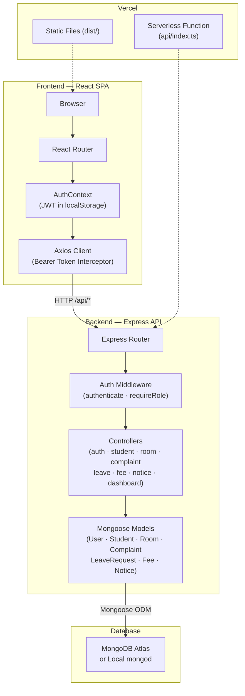
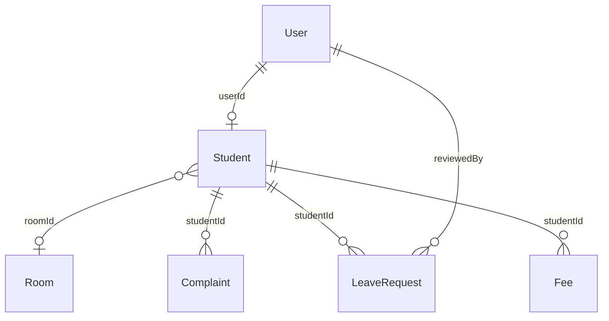

# 🏠 Smart Hostel Management System

A full-stack web application that digitises college hostel operations — room allocations, complaints, leave requests, fee management, and notice boards — through role-based dashboards for administrators and students.

> **Academic Project** — Gujarat Technological University (GTU) · B.E. Semester 5  
> Subjects: Web Application Development (WAD) & Advanced Database Management System (ADBMS)

[](https://react.dev)
[](https://www.typescriptlang.org)
[](https://vite.dev)
[](https://tailwindcss.com)
[](https://expressjs.com)
[](https://mongoosejs.com)
[](https://vercel.com)

---

## 📑 Table of Contents

- [Screenshots](#-screenshots)
- [Features](#-features)
- [Technology Stack](#-technology-stack)
- [Architecture](#-architecture)
- [Project Structure](#-project-structure)
- [Getting Started](#-getting-started)
- [Environment Variables](#-environment-variables)
- [Demo Accounts](#-demo-accounts)
- [Deployment](#-deployment)
- [Database Design](#-database-design)
- [Security](#-security)
- [Documentation](#-documentation)
- [Future Improvements](#-future-improvements)
- [Author](#-author)

---

## 📸 Screenshots

> **Screenshots not yet added.** Place actual screenshots in [`docs/screenshots/`](docs/screenshots/) and update the paths below.

<!-- Uncomment and update paths after adding screenshots:

| Admin Dashboard | Student Dashboard |
|:---:|:---:|
|  |  |

| Room Management | Complaint Management |
|:---:|:---:|
|  |  |

-->

---

## ✨ Features

### Admin (Warden) Portal

| Module | Description |
|---|---|
| **Dashboard** | Aggregated statistics — student counts, room occupancy rate, complaint/leave/fee summaries, room distribution by block, and recent activity feed. Powered by MongoDB aggregation pipelines. |
| **Student Directory** | Search, filter (department, semester, allocation status), and paginate students. Create, edit, and delete student accounts. |
| **Room Inventory** | Manage rooms with block/status/type filters. Track capacity, occupancy, and current occupants per room. |
| **Room Allocations** | Allocate students to rooms with bed assignment. Deallocate students. Automatic occupancy counter and status transitions (Available ↔ Full). |
| **Complaints** | View all complaints with status/category/priority filters. Update status (Pending → In Progress → Resolved/Rejected) with resolution remarks. |
| **Leave Requests** | Review and approve/reject leave applications with admin remarks. |
| **Fee Management** | Create fee invoices, update payment status, and mark fees as paid with auto-generated receipt numbers. |
| **Notice Board** | Create, edit, and delete hostel notices with category and priority. |

### Student Portal

| Module | Description |
|---|---|
| **Dashboard** | Personal overview — profile, room info, roommates, recent complaints, upcoming leaves, fee status, and latest notices. |
| **Profile** | View enrollment details, department, semester, and guardian information. |
| **Room & Roommates** | View allocated room details and roommate contact information. |
| **Complaints** | Submit new complaints and view complaint history. |
| **Leave Requests** | Apply for leave and track approval status. |
| **Fees** | View fee invoices and simulate fee payment. |
| **Notices** | View active hostel notices from administration. |

### Authentication

- JWT-based email/password login with role detection
- Automatic redirect to role-specific dashboard
- Session verification on page load via `/api/auth/me`
- Password change for authenticated users

---

## 🛠 Technology Stack

| Layer | Technology | Purpose |
|---|---|---|
| Frontend | **React 19** | Component-based SPA with hooks and context API |
| Language | **TypeScript 7** | Static typing across frontend and backend |
| Build | **Vite 8** | Fast HMR dev server and optimised production bundling |
| Styling | **Tailwind CSS 4** | Utility-first responsive design |
| Routing | **React Router DOM 7** | Client-side routing with role-guarded layouts |
| Icons | **Lucide React** | Consistent icon library |
| Animation | **Motion (Framer Motion)** | UI micro-animations and transitions |
| HTTP | **Axios** | API client with JWT interceptors and 401 handling |
| Backend | **Node.js + Express 4** | RESTful API with JSON body parsing and error middleware |
| Auth | **jsonwebtoken + bcryptjs** | JWT signing/verification and password hashing (10 salt rounds) |
| Database | **MongoDB (Mongoose 9)** | Document storage with schemas, indexes, population, and aggregation |
| Dev Runner | **tsx** | Direct TypeScript execution for the server |
| Deployment | **Vercel** | Static hosting + serverless API functions |

---

## 🏗 Architecture



**Request flow:** React renders pages by role → Axios sends requests with `Bearer <JWT>` → Express routes through `authenticate` + `requireRole` middleware → Controllers execute business logic via Mongoose → JSON responses flow back to the client. A response interceptor clears `localStorage` on HTTP 401 to force re-login.

---

## 📁 Project Structure

```
smart-hostel-management-system/
├── api/
│   └── index.ts                  # Vercel serverless function entry
├── server/
│   ├── config/db.ts              # MongoDB connection (connectDB, disconnectDB)
│   ├── controllers/              # Route handlers for each module
│   │   ├── authController.ts     #   login, getMe, changePassword
│   │   ├── studentController.ts  #   CRUD + search/filter/pagination
│   │   ├── roomController.ts     #   CRUD + allocate/deallocate
│   │   ├── complaintController.ts
│   │   ├── leaveController.ts
│   │   ├── feeController.ts
│   │   ├── noticeController.ts
│   │   └── dashboardController.ts#   Aggregation-based stats
│   ├── middleware/auth.ts        # JWT authenticate, requireRole
│   ├── models/                   # Mongoose schemas (7 collections)
│   ├── routes/                   # Express route definitions
│   └── seed/seedData.ts          # Demo data seeder
├── src/
│   ├── api/client.ts             # Axios instance with JWT interceptors
│   ├── components/               # Badge, Modal, Navbar, Sidebar, StatCard
│   ├── context/AuthContext.tsx   # Auth state management
│   ├── layouts/DashboardLayout.tsx
│   ├── pages/
│   │   ├── Login.tsx
│   │   ├── admin/                # 8 admin pages (Dashboard → Notices)
│   │   └── student/              # 7 student pages (Dashboard → Notices)
│   └── types/index.ts            # Shared TypeScript interfaces
├── server.ts                     # Dev/local Express server entry
├── index.html                    # Vite HTML entry
├── package.json
├── tsconfig.json
├── vite.config.ts
├── vercel.json                   # Vercel rewrite rules
├── .env.example                  # Environment variable template
└── PROJECT_DOCUMENTATION.md      # Detailed project documentation
```

---

## 🚀 Getting Started

### Prerequisites

- **Node.js** ≥ 18 (LTS recommended)
- **npm** (bundled with Node.js)
- **MongoDB** — local [Community Server](https://www.mongodb.com/try/download/community) or [MongoDB Atlas](https://www.mongodb.com/cloud/atlas) cluster
- **Git**

### Setup

```bash
# 1. Clone the repository
git clone https://github.com/juned-builds/Smart-Hostel-management-System-.git
cd Smart-Hostel-management-System-

# 2. Install dependencies
npm install

# 3. Create the environment file
cp .env.example .env
# Edit .env — set your MONGODB_URI and a strong JWT_SECRET

# 4. Start the development server
npm run dev
```

The app starts at **http://localhost:3001**. On first launch, the database is automatically seeded with demo data if the `users` collection is empty.

### Available Scripts

| Command | Description |
|---|---|
| `npm run dev` | Start dev server with Vite middleware |
| `npm run build` | Production build (frontend → `dist/`) |
| `npm start` | Start production server |
| `npm run preview` | Preview the production build via Vite |
| `npm run lint` | Type-check with `tsc --noEmit` |
| `npm run clean` | Remove `dist/` and `server.js` |

---

## 🔐 Environment Variables

Create a `.env` file from the provided template. **Never commit real secrets.**

| Variable | Required | Description |
|---|:---:|---|
| `MONGODB_URI` | ✅ | MongoDB connection string (local or Atlas) |
| `JWT_SECRET` | ✅ | Secret key for signing JWTs — use a strong random string in production |
| `PORT` | — | Server port (default: `3001`) |

```bash
# .env example (use your own values)
MONGODB_URI="mongodb://127.0.0.1:27017/smart_hostel"
JWT_SECRET="replace_with_a_strong_random_secret"
PORT="3001"
```

---

## 👤 Demo Accounts

The database seeds these accounts automatically on first startup:

| Role | Email | Password |
|---|---|---|
| Admin (Warden) | `admin@hostel.com` | `admin123` |
| Student | `student@hostel.com` | `student123` |

Additional student accounts: `priya@hostel.com`, `aarav@hostel.com`, `ananya@hostel.com`, `rohit@hostel.com` — all with password `student123`.

> ⚠️ **These credentials are for demonstration only.** Never reuse demo passwords in a production deployment. The demo data can be restored using the "Reset Demo Data" button in the navbar (development mode only).

---

## ☁️ Deployment

The project is configured for **Vercel** with `vercel.json` rewrite rules:

- `/api/*` requests route to the serverless function (`api/index.ts`)
- All other requests serve `index.html` for client-side routing

### Steps

1. Connect the GitHub repository to a Vercel project
2. Set environment variables in the Vercel dashboard:

   | Variable | Value |
   |---|---|
   | `MONGODB_URI` | Your MongoDB Atlas connection string |
   | `JWT_SECRET` | A strong, unique secret |
   | `NODE_ENV` | `production` |

3. Deploy — Vercel runs `npm run build` and serves `dist/` alongside the serverless function

> The database reset endpoint (`POST /api/seed/reset`) is intentionally **not exposed** in the Vercel serverless entry to protect production data.

---

## 📊 Database Design

The application uses **7 MongoDB collections** with Mongoose schemas and document references:

| Collection | Purpose | Key Relationships |
|---|---|---|
| `users` | Login credentials (email, hashed password, role) | — |
| `students` | Student profiles (enrollment, department, semester, guardian info) | References `User` and `Room` |
| `rooms` | Room inventory (block, floor, capacity, occupancy, rent, type) | — |
| `complaints` | Issue reports (category, priority, status, resolution) | References `Student` |
| `leaverequests` | Leave applications (type, dates, approval status) | References `Student` and `User` (reviewer) |
| `fees` | Fee invoices (amount, payment status, receipt) | References `Student` |
| `notices` | Hostel announcements (category, priority, active status) | — |



---

## 🔒 Security

| Measure | Implementation |
|---|---|
| **Password Hashing** | bcryptjs with 10 salt rounds — plaintext passwords are never stored |
| **JWT Authentication** | Tokens signed with a server-side secret, verified on every protected request, 7-day expiry |
| **Role-Based Auth** | `requireRole()` middleware enforces route-level access control |
| **Data Isolation** | Student endpoints filter by authenticated student ID, preventing cross-student access |
| **Input Normalisation** | Emails lowercased and trimmed; enrollment numbers uppercased — prevents casing duplicates |
| **Startup Validation** | Server exits immediately if `JWT_SECRET` is missing |
| **Auto-Logout** | Frontend clears credentials on HTTP 401 responses |
| **Secret Exclusion** | `.env` files excluded from Git; `.env.example` provides a template with placeholders |

---

## 📖 Documentation

For comprehensive documentation including the full API reference, database schemas, route permissions, troubleshooting guide, and responsive UI details, see:

**➡️ [PROJECT_DOCUMENTATION.md](PROJECT_DOCUMENTATION.md)**

---

## 🔮 Future Improvements

These are **planned enhancements**, not currently implemented:

- **Payment Gateway Integration** — Razorpay or Stripe for real fee collection (currently simulated)
- **Email Notifications** — Automated alerts for leave approvals, complaint updates, and fee reminders
- **Image Uploads** — Attach photos to complaints via Cloudinary or S3
- **Automated Testing** — Unit and integration tests with Vitest and Supertest
- **Rate Limiting** — Brute-force protection on authentication endpoints
- **Dark Mode** — Theme toggle for the entire portal
- **Audit Logging** — Track administrative actions beyond Mongoose timestamps

---

## 👨‍💻 Author

**Juned Ansari**

- GitHub: [@juned-builds](https://github.com/juned-builds)

Built as an academic project for GTU B.E. Semester 5 (WAD & ADBMS).

---

<div align="center">

Made with React, TypeScript, Express, and MongoDB

</div>
